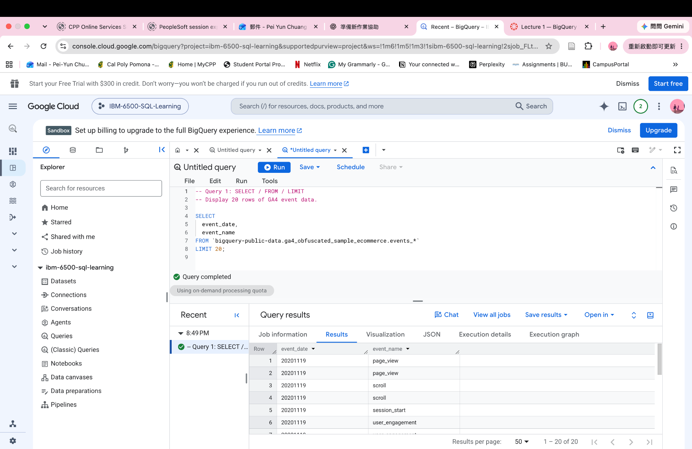
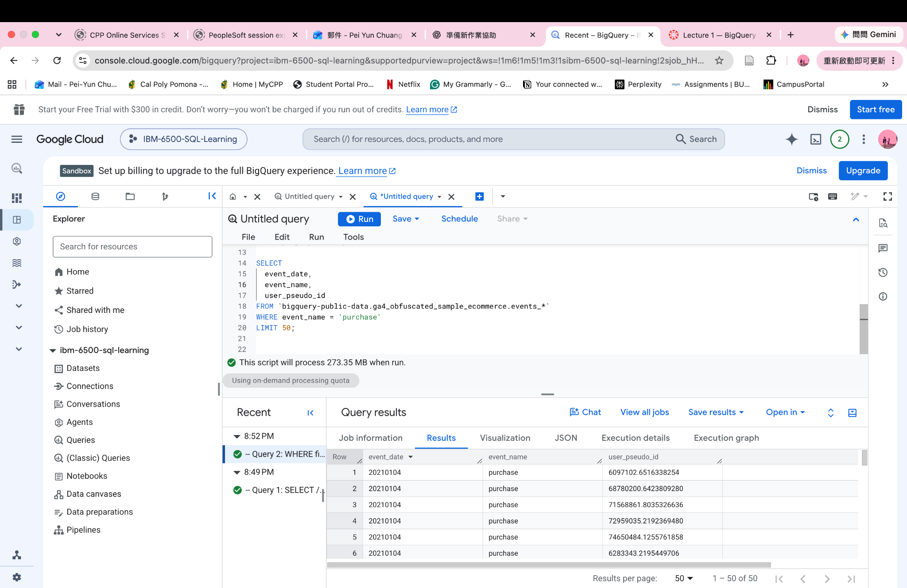
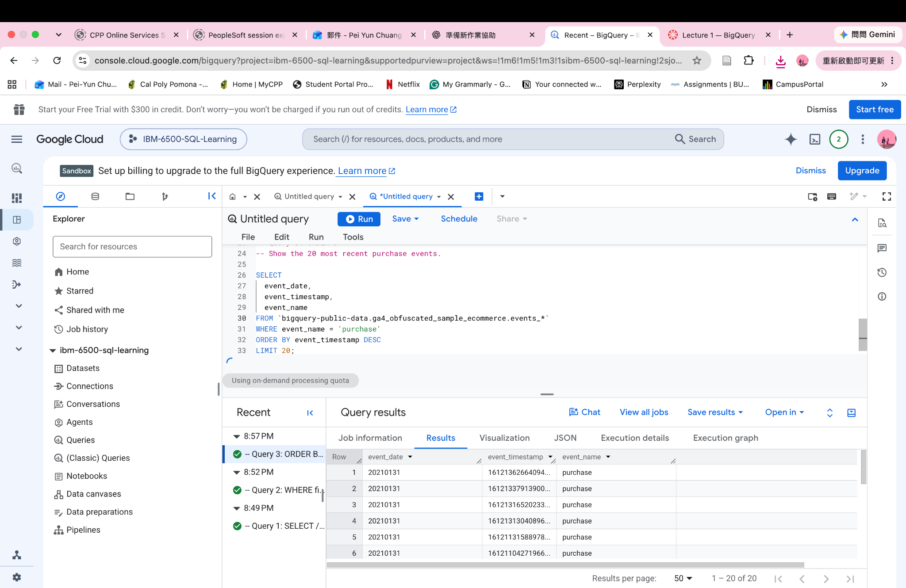
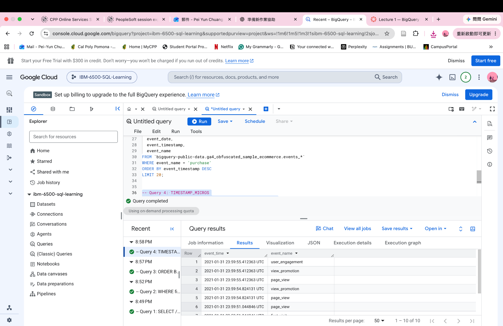
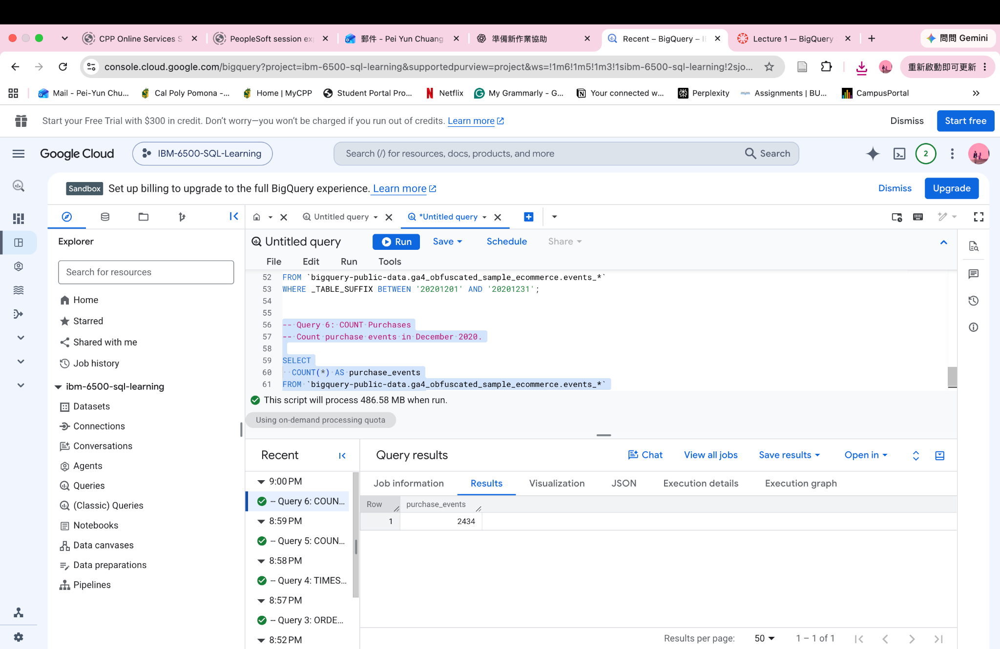
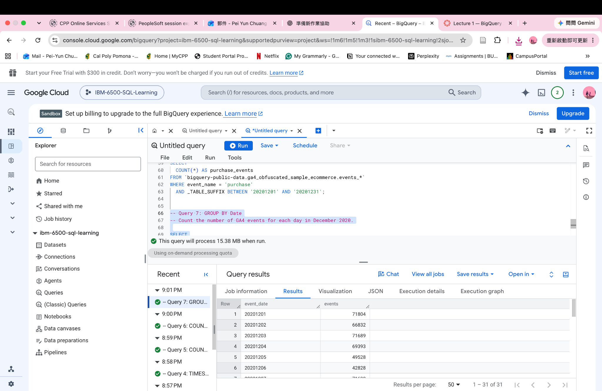
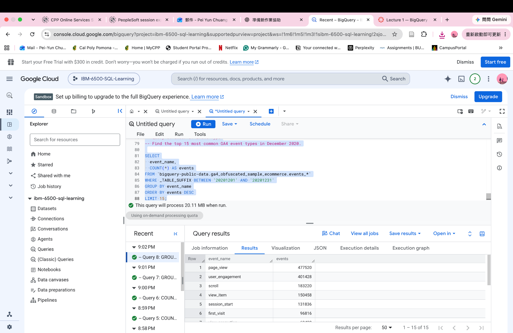
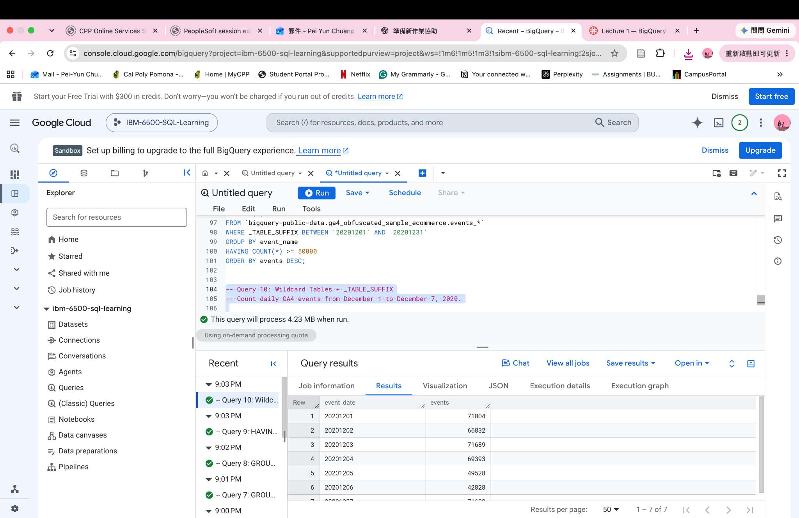

## Overview

This report documents ten SQL exercises completed in Google BigQuery using the public GA4 sample ecommerce dataset. SQL code is displayed for reference; queries were executed in BigQuery, not during Quarto rendering. Screenshots show the recorded results.

## Query 1: SELECT / FROM / LIMIT

Display 20 rows of GA4 event data.

```sql
SELECT
  event_date,
  event_name
FROM `bigquery-public-data.ga4_obfuscated_sample_ecommerce.events_*`
LIMIT 20;
```



## Query 2: WHERE filters rows

Display up to 50 purchase events.

```sql
SELECT
  event_date,
  event_name,
  user_pseudo_id
FROM `bigquery-public-data.ga4_obfuscated_sample_ecommerce.events_*`
WHERE event_name = 'purchase'
LIMIT 50;
```



## Query 3: ORDER BY

Show the 20 most recent purchase events.

```sql
SELECT
  event_date,
  event_timestamp,
  event_name
FROM `bigquery-public-data.ga4_obfuscated_sample_ecommerce.events_*`
WHERE event_name = 'purchase'
ORDER BY event_timestamp DESC
LIMIT 20;
```



## Query 4: TIMESTAMP_MICROS

Convert GA4 timestamps into readable dates and times.

```sql
SELECT
  TIMESTAMP_MICROS(event_timestamp) AS event_time,
  event_name
FROM `bigquery-public-data.ga4_obfuscated_sample_ecommerce.events_*`
ORDER BY event_timestamp DESC
LIMIT 10;
```



## Query 5: COUNT Total Events

Count all GA4 events in December 2020.

```sql
SELECT
  COUNT(*) AS event_count
FROM `bigquery-public-data.ga4_obfuscated_sample_ecommerce.events_*`
WHERE _TABLE_SUFFIX BETWEEN '20201201' AND '20201231';
```


## Query 6: COUNT Purchases

Count purchase events in December 2020.

```sql
SELECT
  COUNT(*) AS purchase_events
FROM `bigquery-public-data.ga4_obfuscated_sample_ecommerce.events_*`
WHERE event_name = 'purchase'
  AND _TABLE_SUFFIX BETWEEN '20201201' AND '20201231';
```



## Query 7: GROUP BY Date

Count the number of GA4 events for each day in December 2020.

```sql
SELECT
  event_date,
  COUNT(*) AS events
FROM `bigquery-public-data.ga4_obfuscated_sample_ecommerce.events_*`
WHERE _TABLE_SUFFIX BETWEEN '20201201' AND '20201231'
GROUP BY event_date
ORDER BY event_date;
```



## Query 8: GROUP BY Event Type

Find the top 15 most common GA4 event types in December 2020.

```sql
SELECT
  event_name,
  COUNT(*) AS events
FROM `bigquery-public-data.ga4_obfuscated_sample_ecommerce.events_*`
WHERE _TABLE_SUFFIX BETWEEN '20201201' AND '20201231'
GROUP BY event_name
ORDER BY events DESC
LIMIT 15;
```



## Query 9: HAVING

Show event types with at least 50,000 events in December 2020.

```sql
SELECT
  event_name,
  COUNT(*) AS events
FROM `bigquery-public-data.ga4_obfuscated_sample_ecommerce.events_*`
WHERE _TABLE_SUFFIX BETWEEN '20201201' AND '20201231'
GROUP BY event_name
HAVING COUNT(*) >= 50000
ORDER BY events DESC;
```


## Query 10: Wildcard Tables + _TABLE_SUFFIX

Count daily GA4 events from December 1 to December 7, 2020.

```sql
SELECT
  event_date,
  COUNT(*) AS events
FROM `bigquery-public-data.ga4_obfuscated_sample_ecommerce.events_*`
WHERE _TABLE_SUFFIX BETWEEN '20201201' AND '20201207'
GROUP BY event_date
ORDER BY event_date;
```



## Summary

These queries demonstrate selecting and filtering GA4 events, sorting by timestamps, converting timestamps, counting events, grouping, filtering aggregated results, and using wildcard tables with `_TABLE_SUFFIX`.


## Published Report and Source Code

After publishing this project to GitHub Pages, replace the placeholders below with your actual URLs.

- **HTML Report:** [View the published HTML report](https://YOUR-USERNAME.github.io/YOUR-REPOSITORY/)
- **GitHub Repository:** [View the source code on GitHub](https://github.com/candicechuang/W04-BigQuery-SQL-Lecture-1.git)
